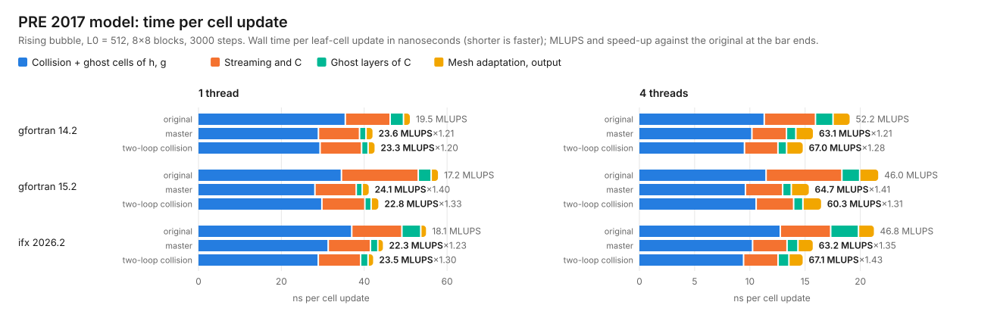

# PRE 2017 model: performance after the kernel study, 2026-11-27

The findings of the kernel study (`2026-11-26-kernel-performance.md`) were
applied to the PRE 2017 model. Three states of the code are compared:

| name        | commit  | collision of the PRE 2017 model |
|-------------|---------|---------------------------------|
| before      | 209db98 | as before the kernel study |
| four passes | 7f1bdeb | kernel study merged; collision unchanged |
| one loop    | this change | collision rewritten as described below |

Results:

* From *before* to *four passes* a rising-bubble run gets 1.21 to 1.41
  times faster. This comes from the changes shared by all models: streaming,
  ghost cells of h and g, ghost layers of C.
* From *four passes* to *one loop*, at 1 thread, a run changes by +4 to
  +8 % with ifx, -3 to -4 % with gfortran 14.2 and -1 to -8 % with gfortran
  15.2. The timing noise is 3-4 %. *One loop* is adopted.
* The `!$OMP SIMD` directives of the model are removed. With and without
  them the kernel timings agree within 2 %.
* `DO CONCURRENT` and three other arrangements of the collision were
  measured and not adopted.
* With the block pool in L3, as in the solver, the collision kernel is
  limited by memory traffic.

All throughput numbers are MLUPS: million leaf-cell updates per second of
wall time. Percentages are changes of MLUPS; positive is faster.

## Setup

* Machine: Intel Xeon (Emerald Rapids, AVX-512), 4 cores of a virtual
  machine, 2 MiB L2 per core, no hardware counters.
* Compilers: gfortran 14.2, gfortran 15.2, ifx 2026.2, with the flags of
  the CMake build (256-bit vectors).
* Whole runs: rising bubble with `amr_lbm_pre2017`,
  `-DAMR_L0=512 -DAMR_MIN_LEVEL=3`, 8x8 blocks, 3000 steps. MLUPS counts
  the whole time step: collision, streaming, ghost cells, mesh adaptation.
* Kernel benchmark: sets up the solver's mesh for the rising bubble (492
  leaf blocks, 8.4 MiB, larger than L2), restores the same state before
  every sweep and times one of two paths over all leaf blocks, at 1 thread:
  * *moments + collision* (`model%Moments_and_Collide`), taken on every
    time step;
  * *collision only* (`model%Collide`), taken only on the steps that write
    diagnostics.
* Runs of the states being compared were interleaved. A table row was
  measured in one session. Different tables were measured in different
  sessions, so the same state can differ by a few percent between tables.

## Whole runs: before against four passes

Best of 3 runs.

| compiler      | threads | before | four passes | speed-up |
|---------------|--------:|-------:|------------:|---------:|
| gfortran 14.2 | 1 | 19.5 | 23.6 | 1.21 |
| gfortran 14.2 | 4 | 52.2 | 63.1 | 1.21 |
| gfortran 15.2 | 1 | 17.2 | 24.1 | 1.40 |
| gfortran 15.2 | 4 | 46.0 | 64.7 | 1.41 |
| ifx 2026.2    | 1 | 18.1 | 22.3 | 1.23 |
| ifx 2026.2    | 4 | 46.8 | 63.2 | 1.35 |

The diagnostics of both states agree to the last printed digit (relative
difference at most 6e-7) and the meshes are identical.

The figure shows the same runs as time per cell update, split by stage. Its
third bar, "two-loop collision", is a candidate that was not adopted (see
"Arrangements not adopted"); the adopted *one loop* is not in the figure.

## The collision: four passes against one loop

*Four passes* processes a block in four loops over its cells: chemical
potential, gradient of C, moments of g, collision. The first two store
their result in block-sized arrays. The collision treats opposite
directions as pairs.

*One loop* computes everything in a single loop over the cells, as the
JCP 2016 model does:

* the gradient and the chemical potential of C, without work arrays;
* the moments of g;
* the collision, in which the stress and the two relaxed moments are taken
  from the sums of g over opposite directions, so that no equilibrium of a
  single direction is formed.

Fypp generates two kernels from one template: `Moments_Collision_h_g` for
the *moments + collision* path and `Collision_h_g`, without the moments,
for the *collision only* path. `Moments_g` is kept for the solver's
separate calls of `model%Moments_g`.

Whole runs, best / median of 6 runs. The diagnostics of the two states are
identical in all printed digits.

| compiler      | threads | four passes | one loop | change of best | change of median |
|---------------|--------:|------------:|------------:|------:|------:|
| gfortran 14.2 | 1 | 23.9 / 23.0 | 23.2 / 22.5 | -3 %  | -2 % |
| gfortran 14.2 | 4 | 62.4 / 61.0 | 62.1 / 59.7 | 0 %   | -2 % |
| gfortran 15.2 | 1 | 23.8 / 23.2 | 23.5 / 23.0 | -1 %  | -1 % |
| gfortran 15.2 | 4 | 64.2 / 58.5 | 57.8 / 56.8 | -10 % | -3 % |
| ifx 2026.2    | 1 | 23.0 / 22.5 | 24.1 / 23.7 | +5 %  | +5 % |
| ifx 2026.2    | 4 | 57.6 / 54.7 | 63.9 / 57.0 | +11 % | +4 % |

The comparison was made in three sessions (4, 4 and 6 runs per state; the
table is the third). Change of the best run in each session:

| compiler      | 1 thread         | 4 threads          |
|---------------|------------------|--------------------|
| gfortran 14.2 | -4 %, -4 %, -3 % | -6 %, +13 %, 0 %   |
| gfortran 15.2 | -8 %, -7 %, -1 % | -7 %, -12 %, -10 % |
| ifx 2026.2    | +4 %, +8 %, +5 % | +5 %, +11 %, +11 % |

* ifx is faster in every session.
* gfortran is slower in every session at 1 thread, by an amount close to
  the noise for 14.2 and up to 8 % for 15.2. gfortran 15.2 is also slower
  in every session at 4 threads.
* The 4-thread results of gfortran 14.2 change sign between sessions and
  support no conclusion.

Kernel benchmark, best of 6 runs:

| moments + collision | gfortran 14.2 | gfortran 15.2 | ifx 2026.2 |
|---------------------|--------------:|--------------:|-----------:|
| four passes | 64.4 | 62.7 | 64.2 |
| one loop    | 63.5 (-1 %) | 59.1 (-6 %) | 75.7 (+18 %) |

| collision only | gfortran 14.2 | gfortran 15.2 | ifx 2026.2 |
|----------------|--------------:|--------------:|-----------:|
| four passes | 79.8 | 75.8 | 78.0 |
| one loop    | 88.7 (+11 %) | 82.0 (+8 %) | 94.5 (+21 %) |

The *collision only* path is faster with every compiler, but it runs only
on the steps that write diagnostics.

## Arrangements not adopted

All give results equal to *four passes* to round-off.

| arrangement | description |
|-------------|-------------|
| two loops | a moments loop and a collision loop; each computes the gradient and the chemical potential itself |
| hybrid A | the chemical potential, gradient and moments passes of *four passes*, then the collision loop of *one loop* |
| hybrid B | the chemical potential and gradient passes of *four passes*, then moments and collision in one loop |
| pair sums only | *four passes* with only the collision algebra of *one loop* |

Kernel benchmark, *moments + collision*, change against *four passes*:

| arrangement    | gfortran 14.2 | gfortran 15.2 | ifx 2026.2 |
|----------------|--------------:|--------------:|-----------:|
| two loops      | +1 % | 0 %  | +10 % |
| hybrid A       | -2 to -6 % with all three compilers | | |
| pair sums only | +3 % | -3 % | +1 % |

Whole runs, change against *four passes*, best run:

| arrangement | threads | gfortran 14.2 | gfortran 15.2 | ifx 2026.2 |
|-------------|--------:|--------------:|--------------:|-----------:|
| two loops   | 1 | -1 % | -5 % | +6 % |
| two loops   | 4 | +6 % | -7 % | +6 % |
| hybrid B    | 1 | -4 % | -3 % | +1 % |
| hybrid B    | 4 | -2 % | -1 % | +2 % |

None of them is faster than *one loop* with ifx or faster than *four
passes* with gfortran 15.2.

In the figure "master: four passes" is *four passes*, "one fused loop" is
*one loop* and "moments loop + collision loop" is *two loops*.

Two further changes made no measurable difference to the kernel and were
not applied:

* the `!$OMP SIMD` directive on the cell loops: within 2 % with and
  without it (it is now removed);
* computing the relaxation time, its inverse and the inverse density from
  one or two divisions instead of three: within the noise.

## `DO CONCURRENT` in place of `DO j` / `DO i`

Applied to the collision loops of the PRE 2017 model (*four passes*) and
of the JCP 2016 model, without the `!$OMP SIMD` directive and without a
locality clause. Kernel benchmark, *moments + collision*, best of 6 runs.

| compiler      | model    | `DO j` / `DO i` | `DO j` / `DO CONCURRENT (i)` | `DO CONCURRENT (j, i)` |
|---------------|----------|-----:|-----:|-----:|
| gfortran 14.2 | PRE 2017 | 66.9 | 66.7 | 67.6 |
| gfortran 14.2 | JCP 2016 | 67.8 | 68.6 | 68.5 |
| gfortran 15.2 | PRE 2017 | 64.8 | 63.8 | 64.7 |
| gfortran 15.2 | JCP 2016 | 57.0 | 56.1 | 53.7 |
| ifx 2026.2    | PRE 2017 | 64.3 | 14.4 | 26.5 |
| ifx 2026.2    | JCP 2016 | 68.8 | 20.9 | 31.2 |

* gfortran: within the noise, except `DO CONCURRENT (j, i)` for JCP 2016
  with gfortran 15.2 (-6 %). The `DO` loops are already vectorized.
* ifx: 2.2 to 4.5 times slower. With `-qopenmp`, which the build uses, ifx
  compiles every `DO CONCURRENT` as an OpenMP work-sharing loop; its
  optimization report lists these loops as `OMP LOOP`. In the solver they
  are nested in the parallel loop over blocks.
* A `LOCAL( ... )` clause naming all scalars of the loop body does not
  remove the slowdown with ifx (best of 5 runs: PRE 2017 17.4 against 63.2
  for the `DO` loops, JCP 2016 24.8 against 67.3). With gfortran 15.2 it
  makes no difference. gfortran 14.2 rejects the clause as a syntax error.
* ifx 2026.2 has no option that restricts `DO CONCURRENT` on the host to
  SIMD; its `DO CONCURRENT` options concern offload only. The slowdown
  disappears when the two model files are compiled with `-qopenmp-simd`
  instead of `-qopenmp`. They contain no OpenMP construct that needs
  `-qopenmp`. Best of 5 runs:

| ifx, model files with `-qopenmp-simd` | `DO j` / `DO i` | `DO j` / `DO CONCURRENT (i)` | `DO CONCURRENT (j, i)` |
|----------|-----:|-----:|-----:|
| PRE 2017 | 63.6 | 65.1 | 66.0 |
| JCP 2016 | 68.0 | 68.4 | 69.0 |

  The remaining differences (+1 to +4 %) are within the noise.

The `DO` loops are kept: `DO CONCURRENT` is not faster with any compiler,
and with ifx it needs compiler flags per file to avoid a large slowdown.

## What limits `Collision_h_g`

The collision kernel of *four passes* was copied into a standalone program
(gfortran 14.2, 1 thread, 8x8 blocks) and run on pools of blocks sized to
fit in each cache level. "No div" replaces the four divisions and the
square root by multiplications; the results are then wrong and only the
timing is used. Range of two runs.

| pool of blocks | 256-bit | 256-bit, no div | 512-bit | 512-bit, no div |
|----------------|--------:|--------:|--------:|--------:|
| 18 KiB (L1)    | 142     | 146-149 | 171-187 | 240-245 |
| 1.2 MiB (L2)   | 127-131 | 125-130 | 157-161 | 174-178 |
| 37 MiB (L3)    | 87-91   | 82-85   | 88-90   | 90-92   |

* Pool in L3, as in the solver: the kernel is limited by memory traffic.
  All four variants give 82 to 92 MLUPS. A block of 8x8 cells occupies
  18 KiB, which is 284 bytes per cell including the ghost layers; about
  half of it is written back.
* Pool in L1 or L2: the kernel is limited by the throughput of the
  floating-point execution ports. The inner loop has 222 instructions per
  4 cells, of which 157 are vector arithmetic (69 of these FMA), 45 have a
  memory operand and 20 are stores. It runs at about 3 instructions per
  cycle.
* The divisions do not limit the 256-bit code: without them it is 3-5 %
  faster in L1 and equal in L2 and L3. They limit the 512-bit code in L1
  and L2.
* Consequence for the solver: vector width, the divisions and the algebra
  of the collision do not change the speed of this kernel.
* This does not explain why *one loop* is slower with gfortran. On a mesh
  that fits in L2, gfortran 14.2 reaches 73 MLUPS with *four passes* and 71
  with *one loop* on the *moments + collision* path, so the difference is
  in the code gfortran generates for the larger loop body.

Block size, 256-bit, pool in L3:

| block | bytes per cell | MLUPS |
|-------|---------------:|------:|
| 8x8   | 284            | 87-91 |
| 16x16 | 237            | 105   |

A 16x16 block has fewer ghost cells per interior cell and longer contiguous
rows. This compares the kernel only. In a run, 16x16 blocks also refine
more cells around the interface, which was not measured here.
