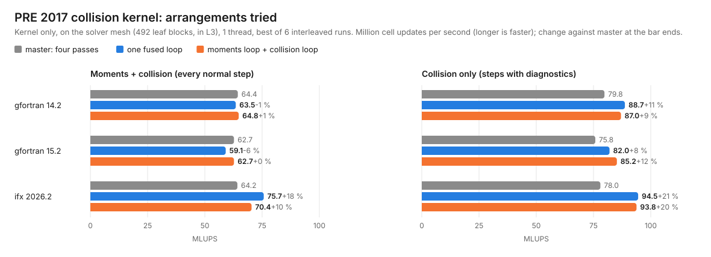

# PRE 2017 model: performance after the kernel study, 2026-11-27

The findings of the kernel study (`2026-11-26-kernel-performance.md`) were
applied to the PRE 2017 model. Outcome:

* The changes that are shared by all models (streaming, ghost cells of h and
  g, ghost layers of C) make the PRE 2017 rising bubble 1.21-1.41 times
  faster than before the study.
* The two levers of the JCP 2016 collision, one fused pass and stress moments
  from pair sums, do **not** carry over to the PRE 2017 collision with
  gfortran. They do with ifx. The model is left as it is.

## Whole runs

Rising bubble with `amr_lbm_pre2017`, `-DAMR_L0=512 -DAMR_MIN_LEVEL=3`, 3000
steps, 8x8 blocks, MLUPS for the whole time step, best of 3. `original` is
commit 209db98, `master` the merged kernel study (7f1bdeb), `two loops` the
candidate described below, which was not adopted.

| build | threads | original | master | | two loops | against master |
|---|---|---|---|---|---|---|
| gfortran 14.2 | 1 | 19.5 | 23.6 | 1.21 | 23.3 | -1 % |
| | 4 | 52.2 | 63.1 | 1.21 | 67.0 | +6 % |
| gfortran 15.2 | 1 | 17.2 | 24.1 | 1.40 | 22.8 | -5 % |
| | 4 | 46.0 | 64.7 | 1.41 | 60.3 | -7 % |
| ifx 2026.2 | 1 | 18.1 | 22.3 | 1.23 | 23.5 | +6 % |
| | 4 | 46.8 | 63.2 | 1.35 | 67.1 | +6 % |

The diagnostics of the three states agree to the last printed digit (6e-7);
the mesh is the same.

## The collision kernel

On master a block is processed in four passes: chemical potential, gradient
of C, moments of g, collision. The collision already pairs opposite
directions. Three rearrangements were tried, all with results equal to
round-off:

* **one loop**: gradient, chemical potential, moments and collision in one
  pass over the cells, the stress and the stress moments from the sums of g
  over the pairs (no equilibrium per direction), every g stored as soon as it
  is computed;
* **two loops**: a moments loop and a collision loop, each with the gradient
  and the chemical potential computed in the loop;
* **hybrid**: the three moments passes of master and the new collision loop.

Kernel only, on the solver's mesh (492 leaf blocks, 8.4 MiB, in L3), 1 thread,
MLUPS, best of 6 interleaved runs:

| moments + collision | gfortran 14.2 | gfortran 15.2 | ifx 2026.2 |
|---|---|---|---|
| master: four passes | 64.4 | 62.7 | 64.2 |
| one loop | 63.5 (-1 %) | 59.1 (-6 %) | 75.7 (+18 %) |
| two loops | 64.8 (+1 %) | 62.7 (0 %) | 70.4 (+10 %) |

| collision only | gfortran 14.2 | gfortran 15.2 | ifx 2026.2 |
|---|---|---|---|
| master | 79.8 | 75.8 | 78.0 |
| one loop | 88.7 (+11 %) | 82.0 (+8 %) | 94.5 (+21 %) |
| two loops | 87.0 (+9 %) | 85.2 (+12 %) | 93.8 (+20 %) |

The hybrid, measured in a run of its own, was 2-6 % slower than master on the
path with the moments for all three compilers.

* The collision alone gets 8-21 % faster with every compiler, but that path
  only runs on the steps with diagnostics.
* On the path of a normal step gfortran gains nothing from any arrangement,
  and gfortran 15 loses 6 % with one loop. The same holds on a small mesh
  that fits in L2 (gfortran 14: 73 MLUPS on master, 71 with one or two
  loops), so memory is not what hides a gain.
* Computing the gradient and the chemical potential once into two small
  arrays and reading them in two loops, as master does, is as cheap as
  computing them in each loop: the hybrid and the two-loop form do not beat
  it.
* Neutral, as for JCP 2016: the `!$OMP SIMD` directive on the loops (within
  2 % either way) and merging the divisions of the relaxation time and the
  density into one (within noise).
* In the solver the two-loop form is 5-7 % slower than master with gfortran
  15, where the kernel benchmark showed no difference.

Why the model is left unchanged: no arrangement is at least as fast as master
with all three compilers on the path that matters. One fused loop would be
worth about 6 % of a run with ifx; keeping it next to the four passes for
gfortran would mean two implementations of the collision.

## Setup

Machine and compilers as in `2026-11-26-kernel-performance.md` (4 cores of a
virtual machine, timing noise of a few percent; no hardware counters). The
kernel benchmark sets up the solver's mesh for the rising bubble, restores
the same state before every sweep, and times
`model%Moments_and_Collide` and `model%Collide` over all leaf blocks.
